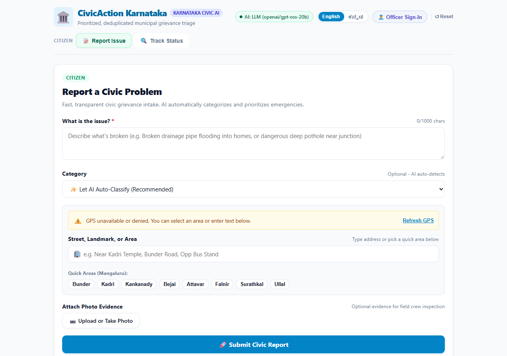
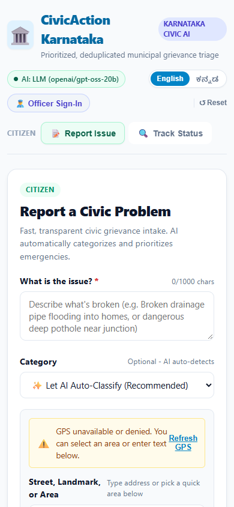
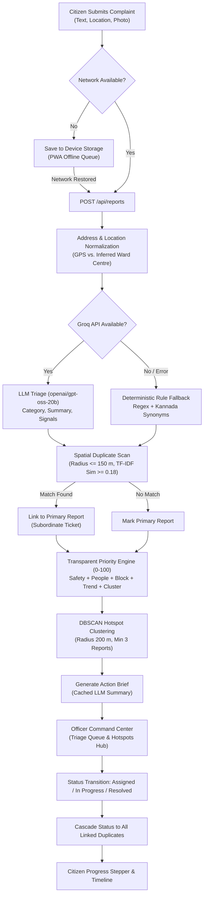
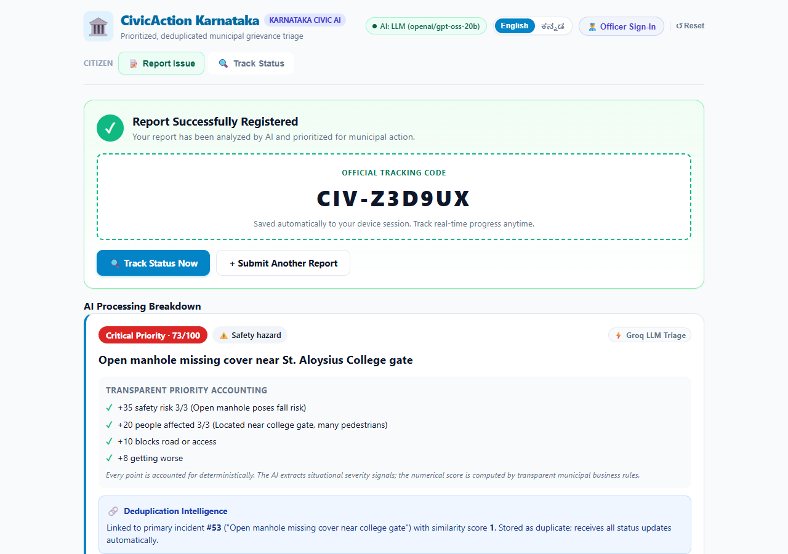
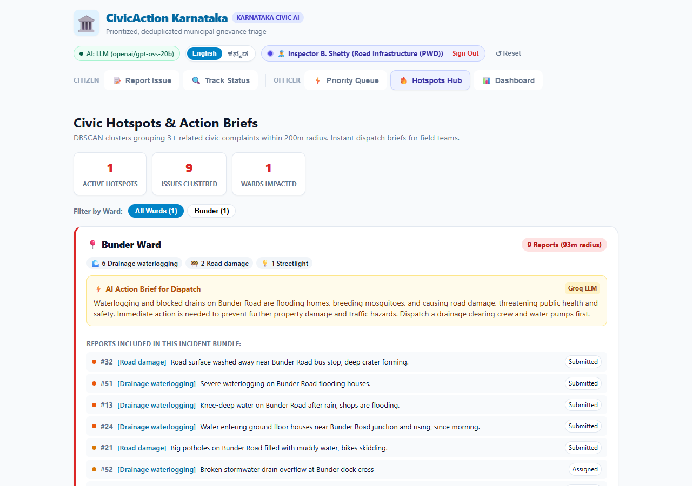
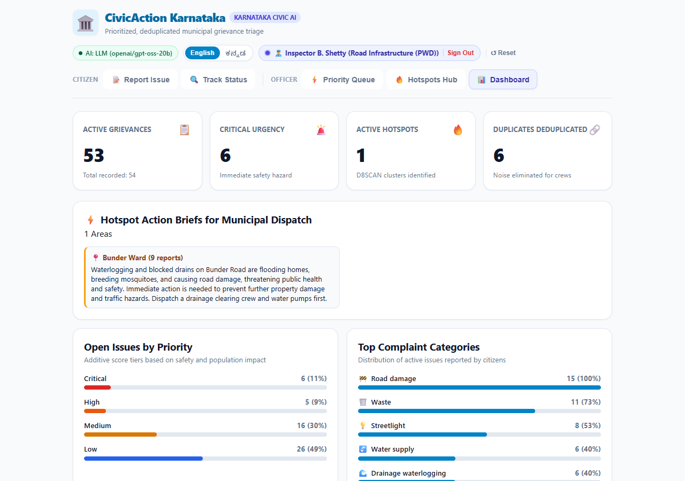
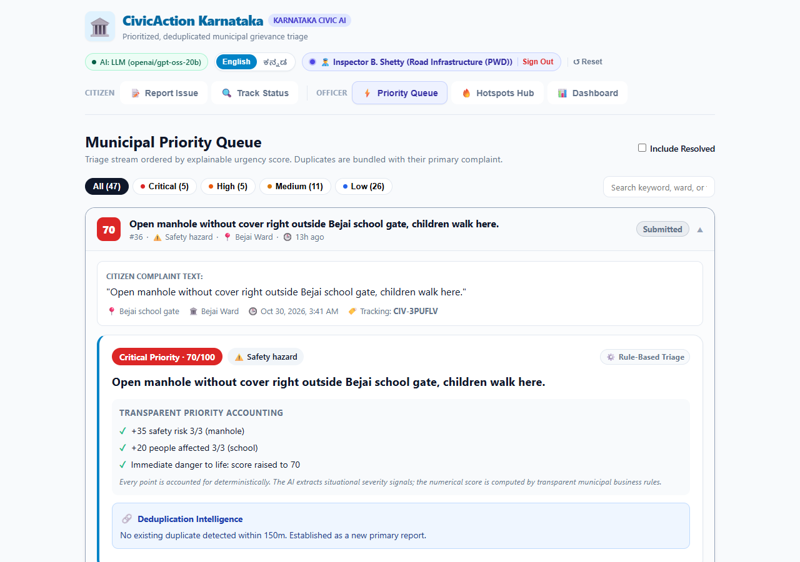
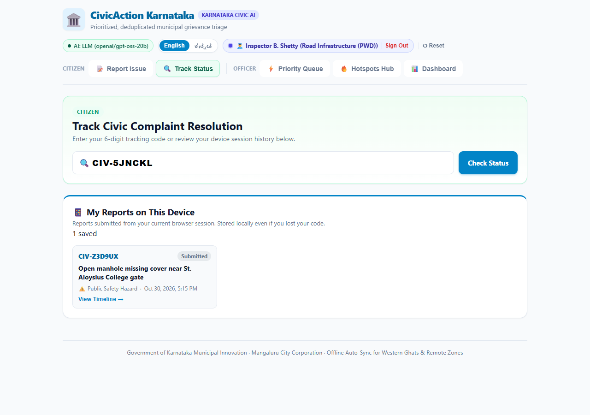
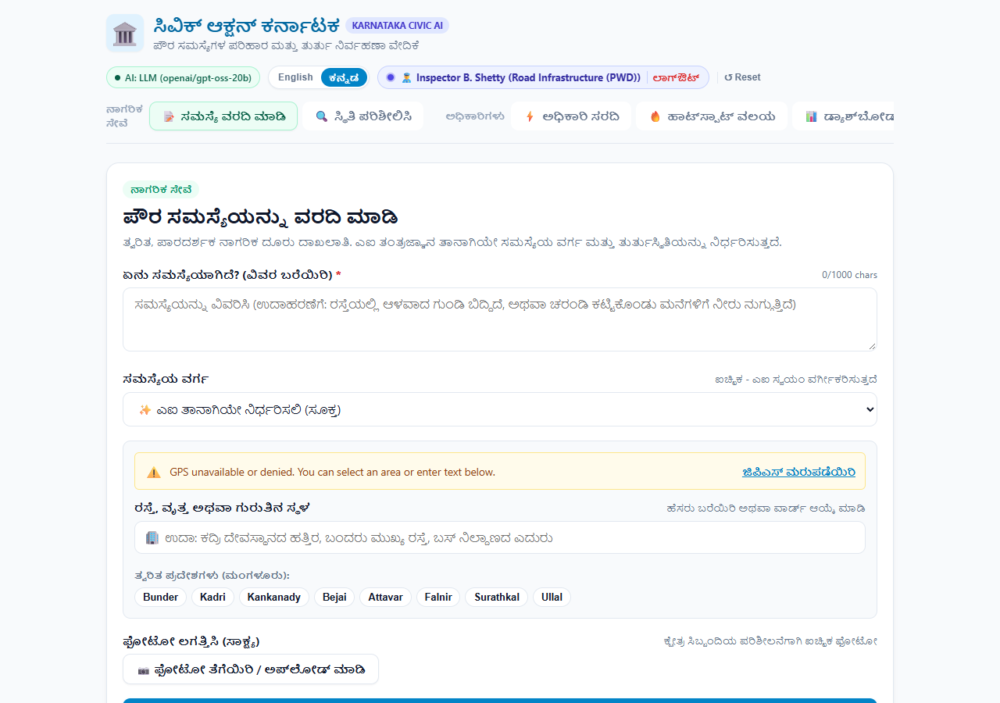
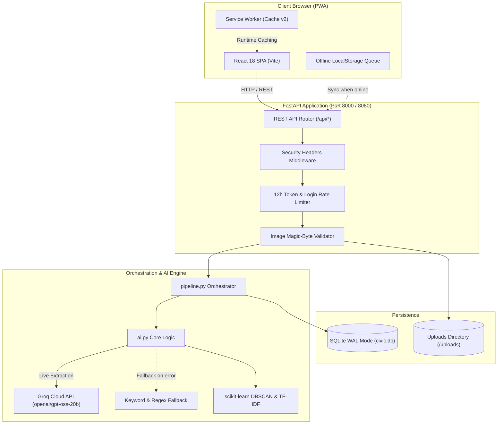

# CivicAction Karnataka — From Complaints to Action

> Automated municipal grievance intake, duplicate detection, explainable priority triage, and incident clustering for Karnataka urban local bodies.

[](#11-testing)
[](LICENSE)
[](backend/)
[](https://fastapi.tiangolo.com)
[](frontend/)

**Live Application:** [https://civicaction.onrender.com](https://civicaction.onrender.com)  
**Source Repository:** [https://github.com/11DDBOY11/PromptwarsxAstra](https://github.com/11DDBOY11/PromptwarsxAstra)  
**Demo Video:** `<add link>` *(link placeholder)*

---

## 1. Interface Overview

| Desktop Report Intake (with Live AI Mode Status) | Mobile Responsive Layout (PWA) |
| :---: | :---: |
|  |  |

---

## 2. The Problem

Municipal grievance portals fail at four distinct operational bottlenecks:
1. **Duplicate Flood:** One burst pipe or crater triggers dozens of separate complaints, overwhelming municipal call centers and causing officer alert fatigue.
2. **Hidden Emergencies:** First-in, first-out queues bury life-threatening hazards (e.g., live sparking wires or open manholes) beneath routine street cleaning requests.
3. **Siloed Incident Response:** Unrelated complaints about the same street corner are routed to separate departments without coordinated dispatch.
4. **The Citizen Black Hole:** Citizens rarely receive updates after lodging a complaint; losing a tracking code means losing all visibility.

---

## 3. The Solution

CivicAction implements an automated pipeline across the four lifecycle stages defined in the challenge brief:

| Stage | What It Does | Implementation | Screenshot |
| :--- | :--- | :--- | :--- |
| **Capture** | Multilingual grievance intake with auto-GPS, address fallback, and offline queueing for Ghats/forest areas | [ReportForm.jsx](civic-action/frontend/src/components/ReportForm.jsx), [offlineQueue.js](civic-action/frontend/src/offlineQueue.js) | [01-report-form.png](docs/screenshots/01-report-form.png) |
| **Understand** | Zero-shot category extraction, concise summary, and structured severity evidence via Groq LLM (with regex rules fallback) | [ai.py](civic-action/backend/app/ai.py) (`understand`, `_llm_json`) | [02-ai-result.png](docs/screenshots/02-ai-result.png) |
| **Reveal** | Spatial deduplication (150 m), transparent 0–100 urgency scoring, and DBSCAN incident clustering (200 m) with dispatch briefs | [pipeline.py](civic-action/backend/app/pipeline.py), [MapView.jsx](civic-action/frontend/src/components/MapView.jsx), [Dashboard.jsx](civic-action/frontend/src/components/Dashboard.jsx) | [03-hotspots.png](docs/screenshots/03-hotspots.png), [04-dashboard.png](docs/screenshots/04-dashboard.png) |
| **Act** | Department officer command center, status updates cascading to duplicates, and public citizen progress tracking | [Queue.jsx](civic-action/frontend/src/components/Queue.jsx), [TrackView.jsx](civic-action/frontend/src/components/TrackView.jsx) | [05-officer-queue.png](docs/screenshots/05-officer-queue.png), [06-citizen-tracking.png](docs/screenshots/06-citizen-tracking.png) |

---

## 4. End-to-End Workflow



### 5-Minute Evaluation Walkthrough

| 1. AI Triage Result | 2. Hotspots Hub & Action Brief |
| :---: | :---: |
|  |  |
| *Category, summary, and itemized reasons.* | *Co-located issues bundled into one crew dispatch.* |

| 3. Officer Analytics Dashboard | 4. Priority Queue & Status Controls |
| :---: | :---: |
|  |  |
| *Ward-by-category heat table and KPI tallies.* | *Explainable score order with assignee workflow.* |

| 5. Public Citizen Tracking View | 6. Bilingual Kannada Localization |
| :---: | :---: |
|  |  |
| *No internal scores exposed; device wallet.* | *Full Kannada script support across intake & status.* |

---

## 5. How the AI Works

The AI system uses structured extraction and formulaic scoring: **the LLM supplies qualitative signals, while transparent deterministic math computes the final score**. The LLM never sets priority numbers directly.

### 1. LLM Extraction & Validation
- **Model:** `openai/gpt-oss-20b` via Groq Cloud API (overridable via `LLM_MODEL`).
- **Prompting & Output:** Strict JSON mode (`response_format: {"type": "json_object"}`) enforcing a fixed schema: `category`, `summary` ($\le 20$ words), `safety_risk` (0–3), `people_affected` (0–3), `blocks_access` (bool), `worsening` (bool), and textual `evidence`.
- **Startup Health Check & Fallback:** At application startup, a test prompt runs against the LLM. If the key is omitted or a call fails, `_llm_json` logs the error, sets `llm_last_error`, and falls back to `understand_rules` in [ai.py](civic-action/backend/app/ai.py). `/api/health` reports `ai_mode: "rules"`.

### 2. Spatial Deduplication
- **Spatial Gate:** Only unresolved reports within **150 meters** of the same category are evaluated (`DUP_RADIUS_M = 150`).
- **Text Similarity:** Uses TF-IDF vectorization with unigram/bigram tokenization. If cosine similarity meets or exceeds **0.18** (`DUP_MIN_SIM`), the incoming report links as a subordinate duplicate.
- **Officer Unlink:** Duplication is treated as an algorithmic suggestion. Municipal officers can click "Unlink" at any time via `POST /api/reports/{id}/unlink`.
- **Approximate Location Guard:** Reports lacking GPS coordinates use approximate ward centroids (`location_approx = 1`) and are strictly excluded from duplicate candidate searches.

### 3. Additive Urgency Formula (0–100 Scale)

Priority is calculated deterministically via the following weighted point schedule:

| Signal | Evaluation Criteria | Points Added |
| :--- | :--- | :---: |
| **Safety Risk** | Level 0 (None) / Level 1 (Low) / Level 2 (Moderate) / Level 3 (Severe Hazard) | 0 / +8 / +20 / **+35** |
| **People Affected** | Level 0 (Single) / Level 1 (Few) / Level 2 (Street/Colony) / Level 3 (School/Hospital/Market) | 0 / +4 / +10 / **+20** |
| **Access Blockage** | Blocks main road, gate, or critical public access path | **+10** |
| **Worsening Trend** | Issue spreading, rising water, or deteriorating daily | **+8** |
| **Duplicate Count** | Each confirmed duplicate report adds +5 (capped at 4 duplicates) | **Up to +20** |
| **Hotspot Member** | Belongs to an active spatial cluster ($\ge 3$ co-located issues) | **+7** |
| **Aging Penalty** | Unresolved after 3 days grace period (+1 point per day, capped at 10) | **Up to +10** |
| **Critical Floor** | Severe life hazards (Safety = 3) are automatically elevated to a floor score of 70 | **Min 70** |

**Priority Bands:**
- **Critical:** $\ge 70$ (Immediate dispatch)
- **High:** 50–69 (Target resolution < 24h)
- **Medium:** 30–49 (Target resolution 48–72h)
- **Low:** 0–29 (Routine municipal maintenance)

#### Real Production Worked Example
```json
// Report #51: "Severe drainage waterlogging flooding houses on Bunder Road"
{
  "category": "drainage_waterlogging",
  "priority_score": 55,
  "priority_band": "High",
  "reasons": [
    "+20 safety risk 2/3 (Flooding increases electrocution and structural damage risk.)",
    "+10 people affected 2/3 (Multiple houses flooded, affecting several families.)",
    "+10 blocks road or access",
    "+8 getting worse",
    "+7 part of a hotspot"
  ]
}
```

### 4. Hotspot Clustering & Action Briefs
- **Clustering:** DBSCAN spatial clustering using Haversine distance (`eps = 200 m`, `min_samples = 3`).
- **Action Briefs:** Summarizes up to 12 co-located issues into a 3-sentence decision-maker dispatch brief.
- **Cache Invalidation:** Briefs are cached in SQLite by sorted member ID sets (`member_key`) to eliminate redundant LLM API calls.

---

## 6. Features Inventory

### Citizen Experience
- **Auto-GPS & Landmark Intake:** Automatically acquires device GPS; allows manual text entry or 1-click ward selection.
- **Kannada & English Localization:** Full UI toggle (`English` / `ಕನ್ನಡ`) with Hinglish and Kannada vocabulary normalization (`ಗುಂಡಿ`, `ಚರಂಡಿ`, `ಕಸ`, `ದೀಪ`, `ನೀರು`).
- **Offline PWA Queue:** Caches submissions locally in browser storage when traveling through Western Ghats or remote forest areas without connectivity; auto-syncs when online.
- **Device Report Wallet:** Tracks tickets in browser local storage so citizens never lose tracking status even without ticket codes.
- **Privacy-Safe Tracking:** Citizen tracking view displays timeline and crew assignments without exposing internal urgency scores.

### Municipal Officer Experience
- **Explainable Priority Queue:** Ordered by calculated score with itemized reason audit trails.
- **Subordinate Duplicate Cascade:** Updating a primary report automatically synchronizes status and notes across all linked complaints.
- **Hotspots Hub:** Zero-latency dashboard grouping co-located incidents, eliminating heavy external tile-map dependencies.
- **Administrative Analytics:** Ward-by-category matrix, priority distribution bars, and 10-day intake velocity charts.

---

## 7. Architecture & Tech Stack



### Technology Stack
- **Backend:** Python 3.11, FastAPI, Uvicorn, Pydantic v2
- **Data & ML:** SQLite (WAL mode, parameterized queries), scikit-learn (DBSCAN, TF-IDF Vectorizer), NumPy
- **LLM Integration:** Groq Python SDK (model: `openai/gpt-oss-20b`, fallback: rules)
- **Frontend:** React 18, Vite 5, Vanilla Modular CSS
- **PWA:** Service Worker (`civic-action-v2`), Web App Manifest

### Repository Structure
```
civic-action/
├── backend/
│   ├── app/
│   │   ├── config.py         # Tunables, weights, thresholds, ward coords
│   │   ├── db.py             # SQLite schema, WAL pragma, migrations
│   │   ├── ai.py             # Groq LLM integration, regex fallback, priority math
│   │   ├── pipeline.py       # Report processing, deduplication, cluster refresh
│   │   ├── seed.py           # 45 synthetic demo incidents across Mangaluru
│   │   └── main.py           # FastAPI routes, security middleware, auth
│   ├── tests/
│   │   ├── conftest.py       # Isolated SQLite & fallback test configuration
│   │   ├── test_api.py       # 14 integration & security test suites
│   │   └── test_pipeline.py  # 11 unit & algorithmic test suites
│   └── requirements.txt      # Production dependencies
├── frontend/
│   ├── public/
│   │   ├── manifest.json     # PWA manifest
│   │   └── sw.js             # Service worker runtime cache
│   ├── src/
│   │   ├── components/       # UI modules: Form, Queue, Track, Hotspots, Dash
│   │   ├── i18n.js           # Bilingual localization strings
│   │   ├── offlineQueue.js   # Offline storage & sync management
│   │   └── styles.css        # Responsive mobile/desktop theme
│   └── package.json          # Frontend dependencies
├── Dockerfile                # Multi-stage production container definition
└── .dockerignore             # Docker build exclusion rules
```

---

## 8. Quick Start

### 1. Windows PowerShell
```powershell
# Clone repository
git clone https://github.com/11DDBOY11/PromptwarsxAstra.git
cd PromptwarsxAstra/civic-action

# Run automated one-command launcher
.\run.ps1
```

### 2. macOS / Linux
```bash
git clone https://github.com/11DDBOY11/PromptwarsxAstra.git
cd PromptwarsxAstra/civic-action

chmod +x run.sh && ./run.sh
```

### 3. Manual Startup
```bash
# Backend
cd civic-action/backend
python -m venv .venv
source .venv/bin/activate  # Windows: .\.venv\Scripts\activate
pip install -r requirements.txt
python -m uvicorn app.main:app --host 0.0.0.0 --port 8000

# Frontend (for development)
cd ../frontend
npm install
npm run dev
```
Visit **`http://localhost:8000`** in your browser.

### Environment Variables

| Variable | Purpose | Default |
| :--- | :--- | :--- |
| `GROQ_API_KEY` | Optional API key for live LLM categorization and briefs | *(empty; falls back to rules)* |
| `LLM_MODEL` | Groq model identifier | `openai/gpt-oss-20b` |
| `FALLBACK_ONLY` | When set to `1`, forces deterministic rule-based path | `0` |
| `EMBEDDER` | Duplicate vectorizer (`tfidf` or `st` for sentence-transformers) | `tfidf` |
| `ALLOW_DEMO_RESET` | Allows authenticated officer to trigger `/api/demo/reset` | `0` *(disabled)* |
| `DEMO_OFFICER_PASSWORD` | Overrides password for all demo accounts | *(account specific)* |
| `DB_PATH` | Path to SQLite database file | `backend/data/civic.db` |
| `UPLOAD_DIR` | Path to image uploads directory | `backend/data/uploads` |

### Demo Municipal Officer Credentials

| Department | Email | Password | Role |
| :--- | :--- | :--- | :--- |
| **Roads Infrastructure (PWD)** | `officer.pwd@mangaluru.gov.in` | `officer123` | Road repair & potholes |
| **Stormwater Drainage** | `officer.drainage@mangaluru.gov.in` | `officer123` | Drain clearance & flooding |
| **MCC Administration** | `officer.admin@mangaluru.gov.in` | `admin123` | City Commissioner |

---

## 9. API Reference

All requests and responses use JSON (except file uploads using `multipart/form-data`).

| Method | Endpoint | Auth Required | Description | Request / Body |
| :--- | :--- | :---: | :--- | :--- |
| `GET` | `/api/health` | No | System health and live AI mode | Returns `{ ok, reports, ai_mode, model, llm_last_error }` |
| `POST` | `/api/reports` | No | Submit a new citizen grievance | `multipart/form-data`: `text`, `lat`, `lng`, `address`, `category`, `image` |
| `GET` | `/api/reports` | No | List reports for officer queue | Query params: `status`, `include_duplicates` |
| `GET` | `/api/reports/{id}` | No | Fetch report details with timeline | URL param: `id` |
| `PATCH`| `/api/reports/{id}/status` | **Yes** (Bearer) | Update status and field assignment | JSON: `{ status, assignee, note }` |
| `POST` | `/api/reports/{id}/unlink` | **Yes** (Bearer) | Detach linked subordinate duplicate | URL param: `id` |
| `GET` | `/api/track/{code}` | No | Public citizen tracking | URL param: `code` (e.g. `CIV-5JNCKL`) |
| `GET` | `/api/reports/by-session` | No | Device wallet reports lookup | Query param: `session_id` |
| `GET` | `/api/clusters` | No | List DBSCAN hotspots and briefs | Returns list of cluster objects |
| `GET` | `/api/stats` | No | Aggregate municipal statistics | Counts by status, band, category, and date |
| `POST` | `/api/auth/officer-login` | No | Authenticate officer and issue token | JSON: `{ email, password }` |
| `GET` | `/api/auth/officer-me` | **Yes** (Bearer) | Verify current officer token | Header: `Authorization: Bearer <token>` |
| `POST` | `/api/demo/reset` | **Yes** (Bearer) | Re-seed 45 demo records (if enabled) | Requires `ALLOW_DEMO_RESET=1` |

---

## 10. Testing & Build Metrics

### Pytest Verification
Full deterministic test suite executed against backend:
```powershell
python -m pytest
```
```
============================= test session starts =============================
platform win32 -- Python 3.11.9, pytest-8.4.2, pluggy-1.6.0
rootdir: E:\prompt_wars\Astra\PromptwarsxAstra
configfile: pytest.ini
testpaths: civic-action/backend/tests
collected 25 items

civic-action\backend\tests\test_api.py ..............                    [ 56%]
civic-action\backend\tests\test_pipeline.py ...........                  [100%]
======================== 25 passed, 1 warning in 7.27s ========================
```

#### Test Suite Breakdown
1. **API Integration (14 tests):** Seed verification, full complaint lifecycle, duplicate status cascading, officer unlinking, input validation, statistics & clusters structure, officer auth, 12h token expiry, login throttling (HTTP 429), upload magic-byte rejection, security headers, CORS restriction, session recovery, approximate location exclusion, and Kannada complaint intake.
2. **AI & Pipeline Units (11 tests):** Seed integrity, rule-based category classification, duplicate linking within 150m, near-miss non-merges, priority floor elevation, priority arithmetic sum checks, DBSCAN multi-category detection, new report cluster joining, LLM JSON error handling, signal value clamping (0–3), and regional language synonym mapping.

### Frontend Production Build
Compiled using Vite:
- `dist/index.html`: **0.94 kB** (gzip: 0.57 kB)
- `dist/assets/index-BOsUDnqV.css`: **30.66 kB** (gzip: 6.16 kB)
- `dist/assets/index-B2jLcKXE.js`: **198.79 kB** (gzip: 62.86 kB)
- Total bundle build time: **1.93 seconds**

---

## 11. Security & Privacy

### Implemented Safeguards
- **Authentication:** In-memory bearer tokens with **12-hour expiry**; protected endpoints return 401 upon expiration.
- **Brute-Force Throttling:** 5 failed logins within 60 seconds triggers a 60-second lockout (HTTP 429), evaluating `X-Forwarded-For` for container environments.
- **Upload Validation:** Verified using file magic bytes: JPEG (`\xff\xd8\xff`), PNG (`\x89PNG`), GIF (`GIF8`), and WebP (`RIFF...WEBP`). Mismatches return HTTP 422. Size capped at 5 MB.
- **CORS Protection:** Wildcard CORS is disabled. Restricted to same-origin in production and `localhost:5173` during development.
- **Security Headers:** Injected on all responses:
  - `X-Content-Type-Options: nosniff`
  - `X-Frame-Options: DENY`
  - `Referrer-Policy: no-referrer`
  - `Permissions-Policy: geolocation=(self)`
- **SQL Injection Prevention:** 100% of SQLite database queries use parameterized SQL (`?` placeholders).
- **XSS Prevention:** Zero use of `dangerouslySetInnerHTML`; text is escaped by React's virtual DOM.
- **Secrets Audit:** Verified zero secrets or `.env` files tracked in git repository.

---

## 12. Accessibility & Inclusivity

- **Bilingual Interface:** Instant language toggle between English and Kannada across all views.
- **Mobile First Responsive Layout:** Touch targets $\ge 44\text{px}$, responsive typography, and single-column form flow on viewports down to 360px.
- **Offline Reliability:** Service Worker runtime caching and offline queueing ensures functionality across low-connectivity Western Ghats and rural areas.
- **High-Contrast Indicators:** Color-coded priority bands backed by explicit text labels and numeric badges (does not rely on color alone).

---

## 13. Limitations & Honesty Note

In accordance with hackathon evaluation guidelines, here is an objective assessment of what is production-grade versus prototype:

1. **Authentication:** Auth tokens are stored in-memory (`OFFICER_TOKENS`) and reset upon container restart. Passwords for demo accounts are committed in code with environment variable overrides.
2. **Public Read Endpoints:** `GET /api/reports` and `GET /api/reports/{id}` are unauthenticated to allow easy demo evaluation, exposing raw complaint text and priority scores.
3. **Database Resets:** The hosted container uses SQLite in `/tmp/civic.db`. Container restarts on ephemeral Cloud Run or free-tier Render instances reset data back to the 45 seeded records.
4. **Photo Processing:** Uploaded images are stored on disk and validated via magic bytes, but image content is not analyzed via computer vision. Photos taken while offline are omitted from the offline queue and must be re-attached.
5. **Deduplication Threshold:** The TF-IDF duplicate threshold (`0.18`) was empirically calibrated on the 45 synthetic Mangaluru demo incidents and may require re-tuning for larger corpora.
6. **Ward Coordinates:** Address-based geocoding uses fixed ward centroid coordinates rather than a full GIS gazetteer.

---

## 14. Roadmap

1. **JWT & Identity Provider Migration:** Replace in-memory tokens with signed JWTs and OAuth2 / OpenID Connect municipal single sign-on.
2. **Computer Vision Validation:** Integrate multimodal models to detect blurry, irrelevant, or duplicate complaint photos.
3. **PostGIS Migration:** Transition from SQLite Haversine calculations to PostGIS spatial queries for complex ward boundary polygons.
4. **WhatsApp & SMS Bot:** Add Twilio/Gupshup webhook intake for citizens without smartphones.
5. **Automated SLA Escalation:** Background workers that automatically escalate priority bands when reports remain unassigned beyond SLA thresholds.

---

## 15. Credits & Acknowledgements

Built for the **PromptWars × ASTRA Hackathon** ("From Complaints to Action").  
- Organized by **Hack2skill**, **Google for Developers**, and **Alva's Institute of Engineering and Technology (AIET)**.
- Developed with AI pair-programming assistance from Antigravity (Google DeepMind).
